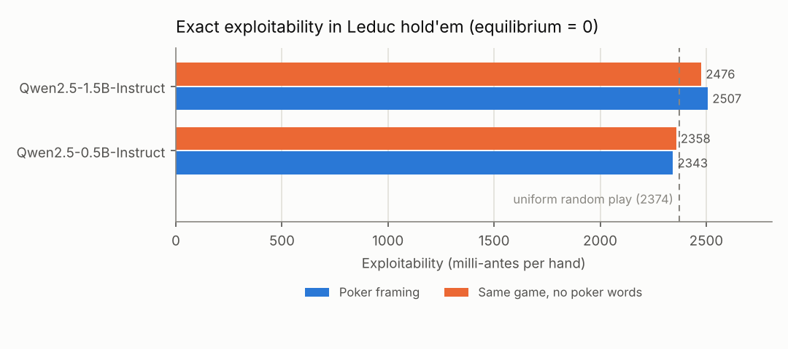
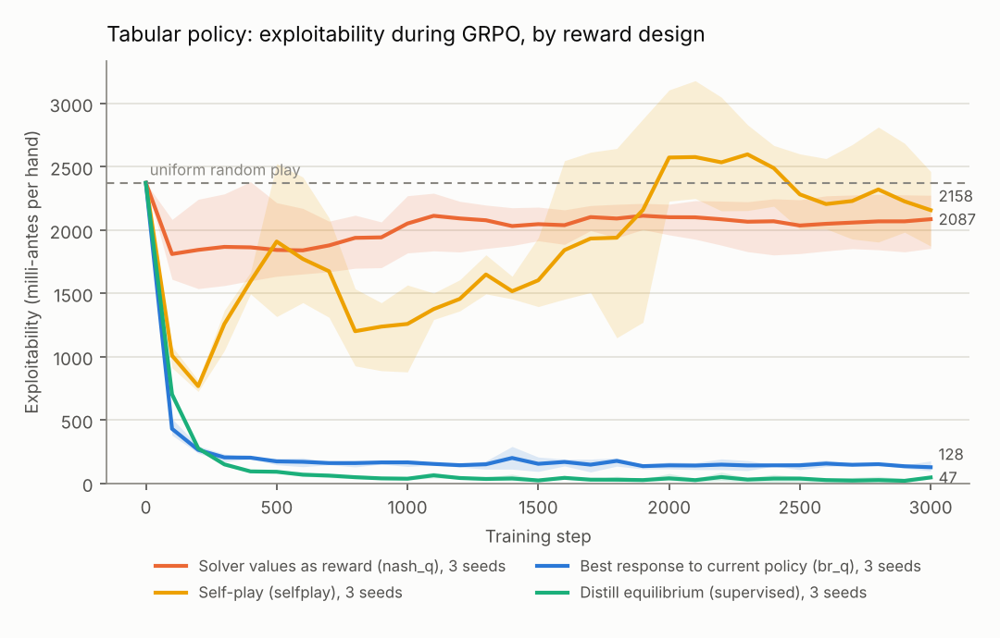
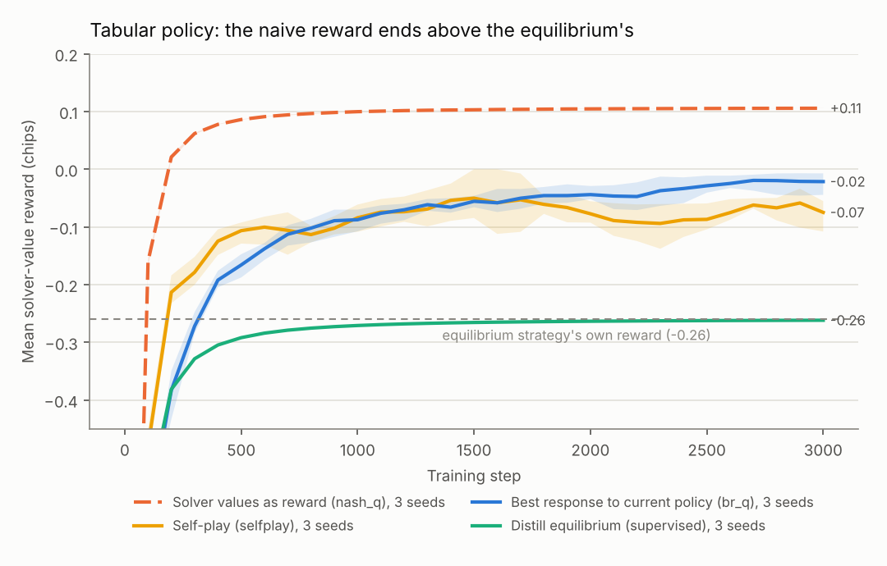

# NashGap

How exploitable is a language model at poker, measured exactly rather than by win
rate? And when you fine-tune it with RL against a game solver, which reward actually
makes it less exploitable?

NashGap reads a model's complete mixed strategy for Kuhn and Leduc hold'em from its
next-token probabilities, then computes its exploitability exactly with a best-response
solver. It then fine-tunes a small open model with GRPO using rewards computed exactly
by the solver, comparing four reward designs.

## Findings

1. **Small instruction-tuned models are about as exploitable as random play in Leduc
   hold'em, because they ignore their own cards.** Qwen2.5-0.5B and 1.5B bet roughly 93%
   of the time whether they hold a pair or a Jack. Their *card sensitivity* (how much
   the strategy changes when only the private card changes, as total variation
   distance) is 0.01 to 0.02; the equilibrium's is 0.57.
2. **Renaming the game changes behavior but not skill.** In an isomorphic tile game
   with every poker word removed, Qwen2.5-0.5B flips from betting 94% of the time to
   betting 11% of the time, and is just as exploitable (2,358 vs 2,343). Its "strategy" is a prior
   attached to vocabulary, not a reading of the rules.
3. **Using the solver's equilibrium values as the RL reward does not work, and the
   reward curve hides it.** At equilibrium every action a player mixes between has the
   same value, so that reward cannot teach how often to bluff. In the tabular setting
   it finishes with a *higher* reward than the equilibrium itself (+0.11 vs -0.26 chips)
   while exploitability stays near uniform random play (about 2,100 vs 2,374
   milli-antes).
4. **Rewarding the policy against a best response to itself, recomputed as it learns
   (exploitability descent), works.** Same GRPO update, same policy: exploitability
   falls from 2,374 to about 100 milli-antes. Self-play with exact values cycles and
   ends where it started.

<!-- LLM_RESULTS -->

## How it works

**Exact grader.** `nashgap/games.py` expands Kuhn (12 information sets) and Leduc
hold'em (288 information sets, 9,457 nodes) into explicit trees. `nashgap/solvers.py`
computes values, reach probabilities, counterfactual action values, exact best
responses and exploitability as level-by-level array passes over the tree, and solves
the game with CFR, CFR+ and discounted CFR. The solver is checked three ways:

| Check | Result |
| --- | --- |
| Best response vs brute force over every pure strategy (Kuhn, both seats, random opponents) | equal to 1e-12 |
| Sequence-form linear program (HiGHS), independent of CFR | Leduc game value -0.085606 for the first player; LP equilibrium exploitability below 1e-9 |
| Discounted CFR, 2,000 iterations | 0.048 milli-antes from equilibrium, same game value as the LP |
| Indifference at equilibrium | every action in the support has equal value, to 1e-6 |

**Reading a model's strategy.** Every information set is rendered as a chat prompt
(rules, your card, the public card, the betting so far, the legal actions). The
probability of each legal action is the probability of its word as the first reply
token, with lowercase and capitalized forms summed, renormalized over legal actions.
That is the model's exact behavioral strategy, with no sampling noise. The rules
prefix is shared by all 288 prompts, so its KV cache is computed once and broadcast.
The batched, cached path matches a plain single-prompt forward pass to 1e-6.

Exploitability is reported in milli-antes per hand: the average over the two seats
of what a best-responding opponent wins, times 1,000. The equilibrium scores 0;
uniform random play scores 2,374 in Leduc.

**Two framings.** `nashgap/prompts.py` renders the same tree as poker, and as a tile
game with tokens, tiles marked 1 to 3, and stay/push/match/quit. The sentences are
parallel, so a difference in play between framings measures reliance on poker
vocabulary.

**GRPO with exact rewards** (`nashgap/rl.py`). A prompt is an information set and a
completion is one action token. For each prompt in a batch, G = 8 actions are sampled,
each is rewarded with its exact expected payoff Q(I, a) in chips, and advantages are
normalized within the group; PPO clipping and an exact KL to the initial policy
complete the GRPO loss. Only the definition of Q changes between runs:

| Reward | Q(I, a) is the expected payoff of taking a at I when... |
| --- | --- |
| `nash_q` | both players follow the equilibrium (a fixed table: "use the solver's values") |
| `br_q` | the opponent best-responds to the current policy, which also plays the continuation; recomputed every few steps |
| `selfplay` | the opponent is a frozen copy of the current policy, refreshed every few steps |
| `distill` | not RL: cross-entropy to the equilibrium strategy, as a reference |

Why `nash_q` fails: by the indifference principle, every action in the support of
the equilibrium strategy at an information set has the same value against the
equilibrium opponent. Group-normalized advantages among those actions are zero, so
nothing pushes the policy toward the right mixture, and actions the opponent's
equilibrium happens to make attractive (often a pure strategy) collect the reward. A
best responder then exploits exactly that.

Why `br_q` works: the gradient of the policy's value against a best response to
itself is the gradient of (minus) its exploitability, so this is exploitability
descent (Lockhart et al., 2019) carried out with GRPO's sampled, group-normalized
update.

## Base models

<!-- BASE_TABLE -->



## Reward design, tabular policy

The same GRPO update on a softmax table with one free logit per action (3 seeds,
3,000 steps, batch 32):

| Reward | Exploitability, start | Final (mean of 3 seeds) | Best seen | Final solver-value reward |
| --- | ---: | ---: | ---: | ---: |
| `nash_q` | 2,374 | 2,087 | 1,539 | +0.11 |
| `selfplay` | 2,374 | 2,158 | 726 | -0.07 |
| `br_q` | 2,374 | 128 | 90 | -0.02 |
| `distill` | 2,374 | 47 | 6 | -0.26 (the equilibrium's own) |




## Reproduce

```bash
pip install numpy scipy pytest                # solver and tests
pytest                                       # 11 solver tests, about 7 s
python scripts/train_tabular.py --seeds 3     # tabular reward comparison, a few minutes
pip install torch transformers peft matplotlib
python scripts/eval_models.py Qwen/Qwen2.5-0.5B-Instruct Qwen/Qwen2.5-1.5B-Instruct
python scripts/train_llm.py --reward br_q     # GRPO with LoRA; also nash_q, selfplay, distill
python scripts/plots.py
```

Everything runs on CPU. Frontier models served through APIs only expose sampled
tokens; their strategies can be estimated the same way by sampling each prompt
repeatedly, which is the obvious next experiment.

## Layout

```text
nashgap/games.py       Kuhn and Leduc rules, explicit game trees
nashgap/solvers.py     values, best response, exploitability, CFR / CFR+ / DCFR
nashgap/lp.py          sequence-form LP equilibrium (independent check)
nashgap/prompts.py     poker and abstract framings
nashgap/llm_policy.py  exact strategy extraction with a shared KV-cache prefix
nashgap/rl.py          GRPO with solver rewards, tabular policy, training loop
nashgap/analysis.py    bet/fold rates and card sensitivity
scripts/               evaluation, training, plotting
results/               raw logs and strategies; figures/ for the charts
```

MIT license.
