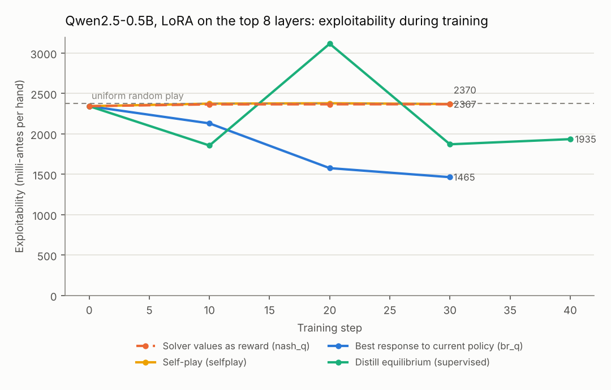
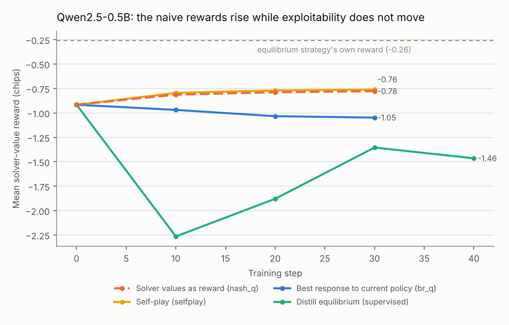

# NashGap

[](https://github.com/tkran2/nashgap/actions/workflows/ci.yml)

How exploitable is a language model at poker, measured exactly rather than by win
rate? And when you fine-tune it with RL against a game solver, which reward actually
makes it less exploitable?

NashGap reads a model's complete mixed strategy for Kuhn and Leduc hold'em from its
next-token probabilities, then computes its exploitability exactly with a best-response
solver. It then fine-tunes a small open model with GRPO using rewards computed exactly
by the solver, comparing four reward designs.

## Findings

1. **The models know their card and ignore it.** For Qwen2.5-0.5B, a linear probe on the
   hidden state at the answer position recovers the player's private card with 100%
   cross-validated accuracy (34% with shuffled labels, chance is 33%), and recovers
   whether it pairs the public card with 100%. Yet the action probabilities barely
   move with it: *card sensitivity* (the total-variation distance between strategies
   at information sets that differ only in the private card) is 0.013, against 0.569
   at equilibrium. All six models tested, from 0.5B to 3B parameters, are card-blind
   (0.013 to 0.058).
2. **So differences between models are differences in card-blind style, not skill,
   and scale does not help.** Qwen3-0.6B checks and folds (bets 4%, folds to 61% of
   bets) and scores 1,188 milli-antes per hand; OLMo-2-1B mixes and scores 1,608. The
   larger models are *more* exploitable because they bet with any hand: Qwen3-1.7B
   (bets 97%) scores 2,486 and Qwen2.5-3B scores 3,282, worse than uniform random play
   (2,374).
3. **Renaming the game changes the style, not the skill.** In an isomorphic tile game
   with every poker word removed, Qwen2.5-0.5B flips from betting 94% of the time to
   11%, and is just as exploitable (2,358 vs 2,343). Qwen3-0.6B gets worse without the
   poker words (1,783), Qwen2.5-3B gets better (2,400 instead of 3,282). The "strategy"
   is a prior attached to vocabulary.
4. **Using the solver's equilibrium values as the RL reward does not work, and the
   reward curve hides it.** At equilibrium every action a player mixes between has the
   same value, so that reward cannot teach how often to bluff. With a tabular policy
   it finishes with a *higher* reward than the equilibrium itself (+0.11 vs -0.26 chips)
   while staying near uniform random play (2,087 vs 2,374). On the LLM the reward rises
   (-0.92 to -0.78) while exploitability does not move (2,343 to 2,367). Self-play
   behaves the same way.
5. **Rewarding the policy against a best response to itself, recomputed as it learns
   (exploitability descent), is the reward that works.** With a tabular policy,
   exploitability falls from 2,374 to about 100. On the LLM it is the only reward that
   lowered exploitability (2,343 to 1,465, -37%), but the model converged to a
   card-blind "always check or call" policy. Supervised distillation toward the
   equilibrium also stayed card-blind. Within this CPU budget (30 to 40 steps, LoRA on
   the top 8 of 24 layers), the bottleneck is wiring an already-represented card into
   the action readout, not the reward.
6. **A GRPO failure mode worth knowing.** At a learning rate that is ordinary for LoRA
   fine-tuning (2e-4), the policy collapsed to a single action at every information
   set within 10 steps. Once all G samples in every group are identical, every
   group-normalized advantage is zero and learning stops for good (100% zero-variance
   groups from step 20 on). At 1e-5 with a KL penalty it learned steadily.

## How it works

**Exact grader.** `nashgap/games.py` expands Kuhn (12 information sets) and Leduc
hold'em (288 information sets, 9,457 nodes) into explicit trees. `nashgap/solvers.py`
computes values, reach probabilities, counterfactual action values, exact best
responses and exploitability as level-by-level array passes over the tree, and solves
the game with CFR, CFR+ and discounted CFR. The solver is checked three ways:

| Check | Result |
| --- | --- |
| Best response vs brute force over every pure strategy (Kuhn, both seats, random opponents) | equal to 1e-12 |
| Sequence-form linear program (HiGHS), independent of CFR | Leduc game value -0.085606 for the first player; LP equilibrium exploitability below 1e-9 |
| Discounted CFR, 2,000 iterations | 0.048 milli-antes from equilibrium, same game value as the LP |
| Indifference at equilibrium | every action in the support has equal value, to 1e-6 |

**Reading a model's strategy.** Every information set is rendered as a chat prompt
(rules, your card, the public card, the betting so far, the legal actions). The
probability of each legal action is the probability of its word as the first reply
token, with lowercase and capitalized forms summed, renormalized over legal actions.
That is the model's exact behavioral strategy, with no sampling noise. The rules
prefix is shared by all 288 prompts, so its KV cache is computed once and broadcast.
The batched, cached path matches a plain single-prompt forward pass to 1e-6.

Exploitability is reported in milli-antes per hand: the average over the two seats
of what a best-responding opponent wins, times 1,000. The equilibrium scores 0;
uniform random play scores 2,374 in Leduc.

**Two framings.** `nashgap/prompts.py` renders the same tree as poker, and as a tile
game with tokens, tiles marked 1 to 3, and stay/push/match/quit. The sentences are
parallel, so a difference in play between framings measures reliance on poker
vocabulary.

**GRPO with exact rewards** (`nashgap/rl.py`). A prompt is an information set and a
completion is one action token. For each prompt in a batch, G = 8 actions are sampled,
each is rewarded with its exact expected payoff Q(I, a) in chips, and advantages are
normalized within the group; PPO clipping and an exact KL to the initial policy
complete the GRPO loss. Only the definition of Q changes between runs:

| Reward | Q(I, a) is the expected payoff of taking a at I when... |
| --- | --- |
| `nash_q` | both players follow the equilibrium (a fixed table: "use the solver's values") |
| `br_q` | the opponent best-responds to the current policy, which also plays the continuation; recomputed every few steps |
| `selfplay` | the opponent is a frozen copy of the current policy, refreshed every few steps |
| `distill` | not RL: cross-entropy to the equilibrium strategy, as a reference |

Why `nash_q` fails: by the indifference principle, every action in the support of
the equilibrium strategy at an information set has the same value against the
equilibrium opponent. Group-normalized advantages among those actions are zero, so
nothing pushes the policy toward the right mixture, and actions the opponent's
equilibrium happens to make attractive (often a pure strategy) collect the reward. A
best responder then exploits exactly that.

Why `br_q` works: the gradient of the policy's value against a best response to
itself is the gradient of (minus) its exploitability, so this is exploitability
descent (Lockhart et al., 2019) carried out with GRPO's sampled, group-normalized
update.

## Base models

Exploitability in milli-antes per hand (lower is better), from exact strategies read off the next-token distribution:

| Model | Leduc, poker framing | Leduc, no poker words | Kuhn, poker framing | Card sensitivity | Bets when unopposed | Folds to a bet |
| --- | ---: | ---: | ---: | ---: | ---: | ---: |
| Qwen3-0.6B | 1,188 | 1,783 | 423 | 0.019 | 4% | 61% |
| OLMo-2-0425-1B-Instruct | 1,608 | 1,556 | 321 | 0.025 | 36% | 33% |
| Qwen2.5-0.5B-Instruct | 2,343 | 2,358 | 335 | 0.013 | 95% | 7% |
| Qwen3-1.7B | 2,486 | 2,724 | 333 | 0.058 | 97% | 0% |
| Qwen2.5-1.5B-Instruct | 2,507 | 2,476 | 333 | 0.021 | 92% | 4% |
| Qwen2.5-3B-Instruct | 3,282 | 2,400 | 299 | 0.028 | 84% | 11% |
| *equilibrium (reference)* | 0 | 0 | 0 | 0.569 | 46% | 48% |
| *uniform random play (reference)* | 2,374 | 2,374 | 458 | 0.000 | 50% | 42% |

Qwen3 models are run with thinking disabled, so their first reply token is the action. Qwen2.5-3B runs in bfloat16 (the others in float32) to fit in memory.


## Reward design, tabular policy

The same GRPO update on a softmax table with one free logit per action (3 seeds,
3,000 steps, batch 32):

| Reward | Exploitability, start | Final (mean of 3 seeds) | Best seen | Final solver-value reward |
| --- | ---: | ---: | ---: | ---: |
| `nash_q` | 2,374 | 2,087 | 1,539 | +0.11 |
| `selfplay` | 2,374 | 2,158 | 726 | -0.07 |
| `br_q` | 2,374 | 128 | 90 | -0.02 |
| `distill` | 2,374 | 47 | 6 | -0.26 (the equilibrium's own) |


## Reward design, Qwen2.5-0.5B with LoRA

GRPO as above on Qwen2.5-0.5B-Instruct, LoRA rank 16 on the top 8 layers, 32
information sets per step, G = 8, learning rate 1e-5 with KL coefficient 0.04 (the
distillation reference uses supervised cross-entropy at 2e-4). Exact exploitability is
measured every 10 steps from the full 288-prompt strategy. One seed per run on CPU.

| Run | Steps | Exploitability, start -> end | Solver-value reward | Card sensitivity | Entropy |
| --- | ---: | --- | --- | ---: | ---: |
| `nash_q` | 30 | 2,343 -> 2,367 | -0.92 -> -0.78 | 0.003 | 0.13 |
| `selfplay` | 30 | 2,343 -> 2,370 | -0.92 -> -0.76 | 0.002 | 0.07 |
| `br_q` | 30 | 2,343 -> **1,465** | -0.92 -> -1.05 | 0.007 | 0.20 |
| `distill` (supervised) | 40 | 2,343 -> 1,935 (min 1,857) | -0.92 -> -1.46 | 0.033 | 0.80 |
| `br_q` at lr 2e-4 (collapsed) | 80 | 2,343 -> 1,467 by step 10, then frozen | | 0.000 | 0.00 |

The rank order matches the tabular experiment: the two rewards that look best on the
solver-value curve are the two that do nothing for exploitability. The greedy policy
`br_q` reaches is "always check or call" (1,467 exactly), a card-blind pure strategy;
for comparison, "check, call, but fold to any bet" scores 1,000 and the equilibrium 0.




## Reproduce

```bash
pip install -r requirements.txt
make test                                     # 28 tests (solver, Kuhn closed form, prompts, RL)
make solve                                    # Leduc: LP value and CFR convergence
make tabular                                  # tabular reward comparison, a few minutes
PYTHONPATH=. python scripts/eval_models.py Qwen/Qwen2.5-0.5B-Instruct Qwen/Qwen2.5-1.5B-Instruct
PYTHONPATH=. python scripts/train_llm.py --reward br_q --steps 30 --lr 1e-5 --beta 0.04
make figures
```

Everything runs on CPU. Frontier models served through APIs only expose sampled
tokens; their strategies can be estimated the same way by sampling each prompt
repeatedly, which is the obvious next experiment.

## Layout

```text
nashgap/games.py       Kuhn and Leduc rules, explicit game trees
nashgap/solvers.py     values, best response, exploitability, CFR / CFR+ / DCFR
nashgap/lp.py          sequence-form LP equilibrium (independent check)
nashgap/prompts.py     poker and abstract framings
nashgap/llm_policy.py  exact strategy extraction with a shared KV-cache prefix
nashgap/rl.py          GRPO with solver rewards, tabular policy, training loop
nashgap/analysis.py    bet/fold rates and card sensitivity
scripts/               evaluation, training, plotting
results/               raw logs and strategies; figures/ for the charts
```

MIT license.
